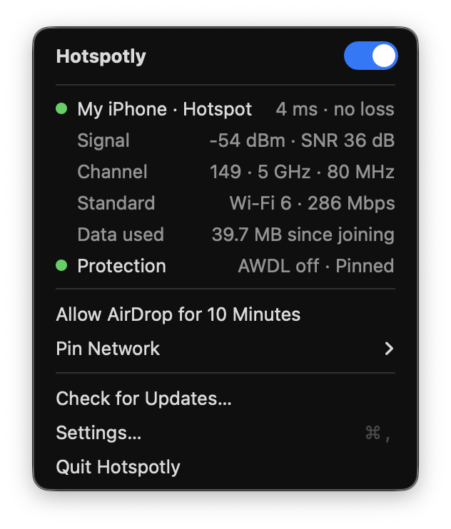
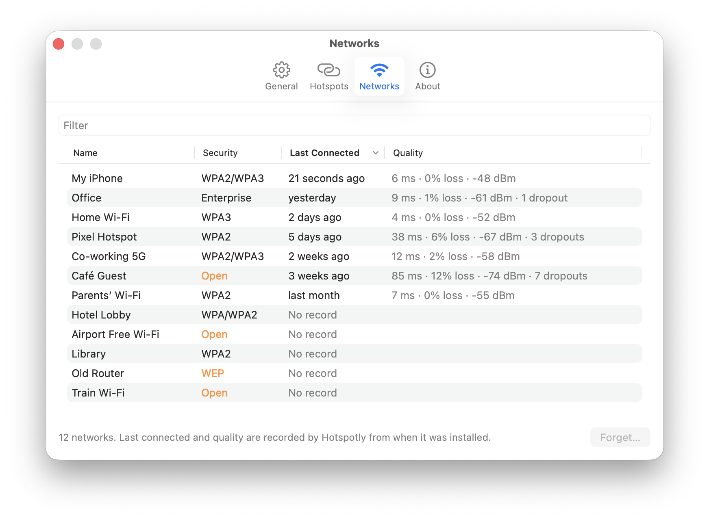
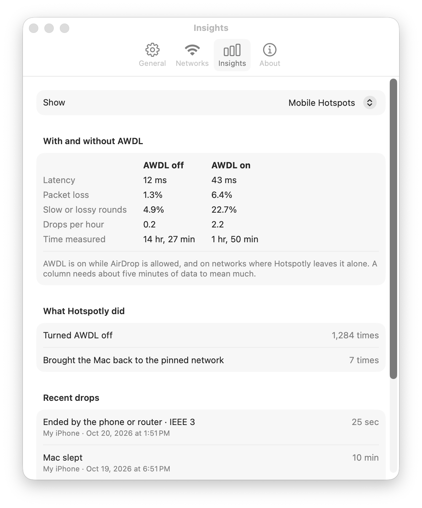

<div align="center">


# Hotspotly

Keeps your Mac steady on your phone's hotspot and on Wi-Fi.

[](https://github.com/minanyang/hotspotly/releases/latest)

[](LICENSE)

**English** · [繁體中文](README.zh-TW.md) · [Download](https://github.com/minanyang/hotspotly/releases/latest/download/Hotspotly.zip)

</div>

<p align="center">
  
</p>

Hotspotly is a menu bar app for Macs that live on a phone's hotspot.

- **Stops hotspot dropouts** by turning off AWDL, the AirDrop radio link that keeps pulling the
  Wi-Fi chip off channel, and keeps an idle hotspot awake.
- **Pins a network**, pulling the Mac back when macOS wanders off to another one.
- **Shows the connection**: latency, packet loss, signal and, on a hotspot, data used.
- **Manages remembered networks**: security, quality, and forgetting several at once.
- **Shows whether it helps**, comparing your networks with AWDL off and on.
- **Updates itself**: signed, notarized, and updated from inside the app.

iPhone hotspots are recognised automatically; Android phones and pocket routers can be marked by
hand. The interface is in English or Traditional Chinese, following the system.

## Install

Requires macOS 13 (Ventura) or later.

1. Download [Hotspotly.zip](https://github.com/minanyang/hotspotly/releases/latest/download/Hotspotly.zip),
   unzip it, and drag **Hotspotly** to Applications.
2. Open it and allow its helper when asked: **Login Items & Extensions → Allow in the Background**
   (see [Permissions](#permissions)). Allow Location too, for network names.
3. Turn on **Open at Login** under **Settings… → General**.

Or run `curl -fsSL https://raw.githubusercontent.com/minanyang/hotspotly/main/install.sh | bash`.
To build from source (needs the Xcode Command Line Tools): `git clone` this repository and run
`make install`.

## Using it

**The menu** has a switch to turn Hotspotly off and two lights, like the two on the icon's router:
the network you are on, with latency and loss to its router (amber: loss or slow; red: no reply),
and protection, AWDL off and on the pinned network (amber: AirDrop allowed or away from the pin).
On a hotspot it adds **Allow AirDrop for 10 Minutes**.

**Pin Network** keeps the Mac on one network. It needs the Wi-Fi password once: type it, or use the
one saved on this Mac. It cannot wake an iPhone hotspot that stopped advertising; the Wi-Fi menu can.

**Settings… → Networks** lists the networks the Mac remembers, with type, security (open and WEP in
orange), when the Mac was last on them and how well they worked. Select some to **Mark as Mobile
Hotspot** or **Forget…** them.

<p align="center">
  <picture>
    <source media="(prefers-color-scheme: dark)" srcset="docs/screenshots/networks-dark.png">
    
  </picture>
</p>

**Settings… → Insights** shows whether Hotspotly helps: latency, loss and drops with AWDL off and on,
recent drops with their cause from the system log, and what Hotspotly did. It stays on your Mac.

<p align="center">
  <picture>
    <source media="(prefers-color-scheme: dark)" srcset="docs/screenshots/insights-dark.png">
    
  </picture>
</p>

**Settings… → General** chooses where AWDL goes off and can hide the menu bar icon (open the app
again to reach its settings). **Settings… → About** controls automatic updates. The log is at
`~/Library/Logs/hotspotly.log`.

## What is AWDL?

AWDL (Apple Wireless Direct Link) is how Apple devices talk directly over Wi-Fi, behind AirDrop,
Handoff, Universal Control and Sidecar. It shares the Mac's single radio and takes it to other
channels several times a second. A home router copes; a phone hotspot often lags or drops.

Turning AWDL off fixes that but stops those features, so by default Hotspotly does it only on mobile
hotspots, and again within milliseconds whenever macOS brings it back. **Turn Off AWDL** under
**Settings… → General** can choose all networks or never instead; quitting Hotspotly turns it back on.
All networks also suits gaming, game streaming, video calls and remote desktop at home, where
AWDL's channel hops show up as brief lag spikes.

## Command line

The app contains a `hotspotly` command. **Settings… → General → Command line tool → Install…** links it to
`/usr/local/bin/hotspotly`; or do it yourself:

```sh
sudo ln -s /Applications/Hotspotly.app/Contents/MacOS/hotspotly /usr/local/bin/hotspotly
```

```
hotspotly status                 what Hotspotly sees right now
hotspotly networks               remembered Wi-Fi networks (* = pinned)
hotspotly pin "<ssid>"           switch to <ssid> and pin it (asks for its password once)
hotspotly pin --here "<ssid>"    pin the network you are on now, named <ssid>
hotspotly unpin
hotspotly mark-hotspot           treat the current network as a hotspot
hotspotly unmark-hotspot
hotspotly pause
hotspotly resume
hotspotly awdl hotspots|all|never  where to turn AWDL off (hotspots, the default)
hotspotly allow-awdl [minutes]   leave AWDL on for a while (default 10 minutes)
hotspotly allow-awdl stop
hotspotly run                    run the loop in the foreground instead of the app (development)
```

The commands change the running app's settings; they need the app to be running, except `run`. On
macOS 26, switching to another network needs location access, which only the app has: pin from the
menu instead of `hotspotly pin "<ssid>"`. `pin --here` works from the command line.

## Permissions

- **Helper (allowed once).** Turning AWDL off needs root, so a small helper does it, along with
  forgetting networks and linking the command line tool. macOS starts it for Hotspotly.app only and
  it stops when the app quits. Without it, keepalive and pinning still work. Versions before 0.6.0
  used a sudoers rule; the helper removes it.
- **Location (optional).** macOS shows Wi-Fi names only to apps with location access; Hotspotly
  needs them for the menu, the Networks tab and marking hotspots. It never reads your location.
- **Login keychain.** Passwords of networks you pin, under `io.github.minanyang.hotspotly`.
- **Network.** Besides pinging your router, Hotspotly fetches `appcast.xml` from GitHub once a day
  to check for updates. Nothing else is sent.

## Uninstall

Choose **Uninstall Hotspotly…** under **Settings… → General**. It removes the helper, the command line link
and the login item, turns AWDL back on, and moves Hotspotly.app to the Trash. Settings and history
in `~/Library/Application Support/hotspotly` stay unless you tick **Also delete settings and history**.

## License

The code is released under the [MIT License](LICENSE). In-app updates use
[Sparkle](https://sparkle-project.org) (MIT License); its license ships in the app as `Sparkle-LICENSE`.

The Hotspotly name and logo are not covered by the MIT License. The logo artwork
(`Resources/AppIcon.icns`, `Resources/MenuBarIcon.pdf`, `Resources/MenuBarIconFilled.pdf`, `docs/icon.png`)
and the script that draws it (`scripts/make-icons.swift`) are © 2026 Min-An Yang (minanyang), all rights reserved. Forks and derivative works must use a different name and logo;
saying a fork is "based on Hotspotly" is fine.
