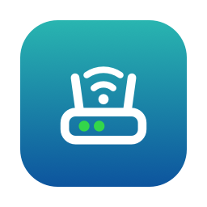
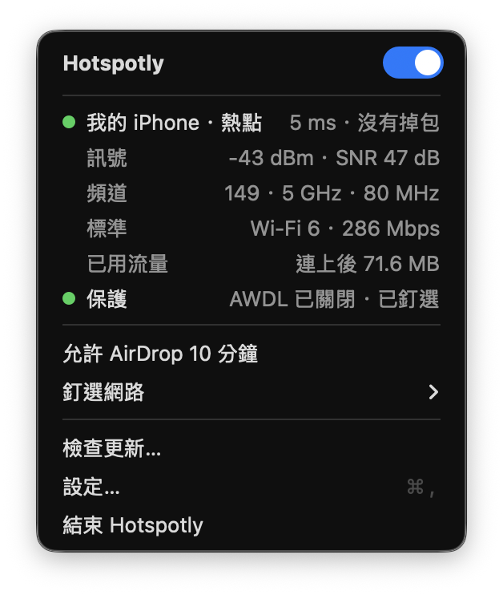
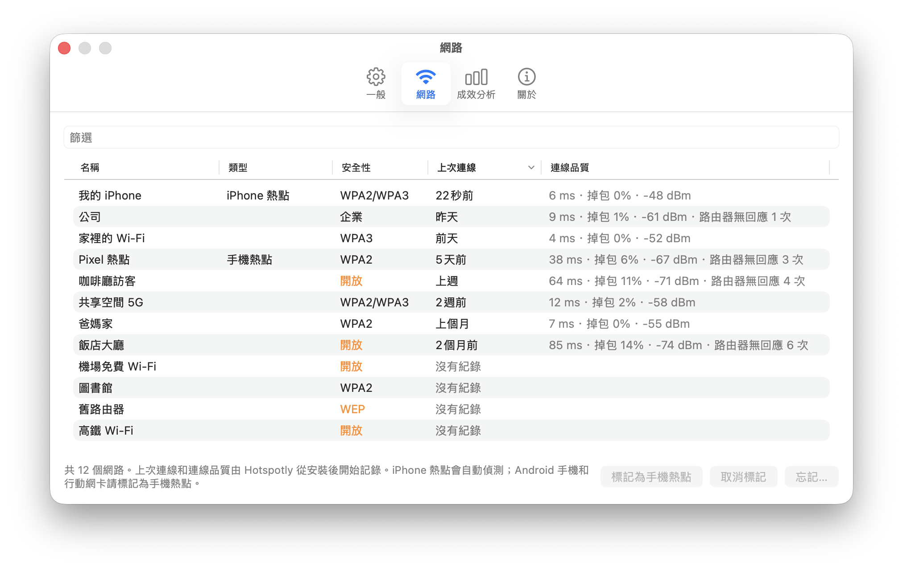
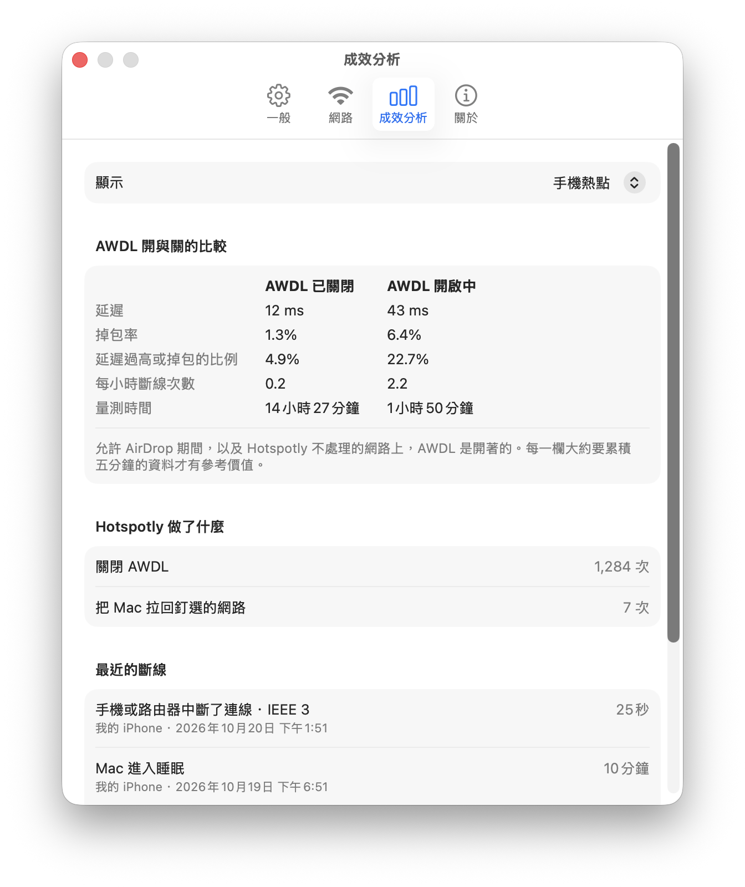

<div align="center">



# Hotspotly

讓 Mac 穩穩連在手機熱點和 Wi-Fi 上。

[](https://github.com/minanyang/hotspotly/releases/latest)

[](LICENSE)

[English](README.md) · **繁體中文** · [下載](https://github.com/minanyang/hotspotly/releases/latest/download/Hotspotly.zip)

</div>

<p align="center">
  
</p>

Hotspotly 是一個選單列 app，給常常連手機熱點的 Mac 使用。

- **防止熱點斷線**：關掉 AWDL（AirDrop 用的無線連線，會不斷把 Wi-Fi 晶片切到別的頻道），並讓閒置的熱點保持開啟。
- **釘選網路**：macOS 自己跑到其他網路時，把 Mac 拉回來。
- **顯示連線狀態**：延遲、掉包、訊號；連著熱點時，還有用了多少流量。
- **管理記住的網路**：安全性、連線品質，可以一次忘記好幾個。
- **告訴你有沒有幫助**：比較同一個網路在 AWDL 關閉和開啟時的表現。
- **自動更新**：有簽章、經過 Apple 公證，在 app 裡就能更新。

iPhone 熱點會自動辨識；Android 手機和行動網卡可以手動標記。介面會跟著系統語言顯示繁體中文或英文。

## 安裝

需要 macOS 13（Ventura）或更新版本。

1. 下載 [Hotspotly.zip](https://github.com/minanyang/hotspotly/releases/latest/download/Hotspotly.zip)，解壓縮後把 **Hotspotly** 拖進「應用程式」。
2. 打開它，依提示在「**登入項目與延伸功能 → 允許在背景執行**」允許輔助程式（原因見[權限](#權限)）；位置權限也請允許，才能顯示網路名稱。
3. 在「**設定… → 一般**」打開「**登入時開啟**」。

也可以執行 `curl -fsSL https://raw.githubusercontent.com/minanyang/hotspotly/main/install.sh | bash`。要從原始碼編譯（需要 Xcode Command Line Tools），`git clone` 這個 repo 後執行 `make install`。

## 使用方式

**選單**有一個關閉 Hotspotly 的開關和兩個燈，就像圖示裡路由器上的兩個燈：目前的網路，顯示到路由器的延遲和掉包（橘燈：掉包或偏慢；紅燈：沒有回應）；以及保護狀態，也就是 AWDL 已關閉、在釘選的網路上（橘燈：正在允許 AirDrop，或離開了釘選的網路）。連著熱點時會多一個「**允許 AirDrop 10 分鐘**」。

「**釘選網路**」讓 Mac 留在同一個網路。第一次需要 Wi-Fi 密碼：直接輸入，或使用這台 Mac 儲存的密碼。iPhone 熱點停止廣播後，Hotspotly 叫不醒它，內建的 Wi-Fi 選單可以。

「**設定… → 網路**」會列出 Mac 記住的網路，包括類型、安全性（開放和 WEP 以橘色標示）、上次連線時間和連線品質。選取後可以「**標記為手機熱點**」或「**忘記…**」。

<p align="center">
  <picture>
    <source media="(prefers-color-scheme: dark)" srcset="docs/screenshots/zh-TW/networks-dark.png">
    
  </picture>
</p>

「**設定… → 成效分析**」告訴你 Hotspotly 有沒有幫助：AWDL 關閉和開啟時的延遲、掉包和斷線，最近的斷線和系統 log 記錄的原因，以及 Hotspotly 做了什麼。資料只會留在你的 Mac 上。

<p align="center">
  <picture>
    <source media="(prefers-color-scheme: dark)" srcset="docs/screenshots/zh-TW/insights-dark.png">
    
  </picture>
</p>

「**設定… → 一般**」可以選擇在哪裡關閉 AWDL，也可以隱藏選單列圖示（要看設定時從「應用程式」再打開一次）。「**設定… → 關於**」可以開關自動更新。Log 檔在 `~/Library/Logs/hotspotly.log`。

## 什麼是 AWDL？

AWDL（Apple Wireless Direct Link）讓 Apple 裝置直接用 Wi-Fi 互相連線，AirDrop、接力、通用控制和隨航都靠它。它和 Wi-Fi 共用 Mac 唯一的一組無線電，每秒好幾次把無線電切到別的頻道。家裡的路由器還能應付；手機熱點則常常延遲飆高，甚至斷線。

關掉 AWDL 就能解決，但那些功能也會跟著不能用，所以 Hotspotly 預設只在手機熱點上關掉它，macOS 把它重新打開時也會在幾毫秒內再關掉。在「**設定… → 一般**」的「**關閉 AWDL**」可以改成所有網路或永不；結束 Hotspotly 後 AWDL 會重新打開。

## 命令列

app 裡附帶一個 `hotspotly` 指令。在「**設定… → 一般 → 命令列工具**」按「**安裝…**」，就會把它連結到 `/usr/local/bin/hotspotly`；也可以自己建立連結：

```sh
sudo ln -s /Applications/Hotspotly.app/Contents/MacOS/hotspotly /usr/local/bin/hotspotly
```

```
hotspotly status                 目前的狀態
hotspotly networks               記住的 Wi-Fi 網路（* = 已釘選）
hotspotly pin "<ssid>"           切換到 <ssid> 並釘選（第一次會問密碼）
hotspotly pin --here "<ssid>"    釘選目前連著的網路，名稱為 <ssid>
hotspotly unpin
hotspotly mark-hotspot           把目前的網路當成熱點
hotspotly unmark-hotspot
hotspotly pause
hotspotly resume
hotspotly awdl hotspots|all|never  在哪裡關掉 AWDL（hotspots，預設）
hotspotly allow-awdl [分鐘]      讓 AWDL 暫時開著（預設 10 分鐘）
hotspotly allow-awdl stop        提早結束
hotspotly run                    不開 app，在前景執行背景迴圈（開發用）
```

除了 `run` 之外，這些指令改的是正在執行的 app 的設定，所以 app 要開著。在 macOS 26 上，切換到其他網路需要位置權限，只有 app 有，所以請從選單釘選，不要用 `hotspotly pin "<ssid>"`；`pin --here` 在命令列仍然可以用。

## 權限

- **輔助程式（只需允許一次）。** 關掉 AWDL 需要 root 權限，所以由一個小型輔助程式負責，它也負責忘記網路和連結命令列工具。macOS 只讓 Hotspotly.app 呼叫它，app 結束時它也跟著結束。沒有它，keepalive 和釘選網路照常能用。0.6.0 以前的版本用的是 sudoers 規則，輔助程式會把它移除。
- **位置（選用）。** macOS 只讓有位置權限的 app 讀取 Wi-Fi 名稱；選單、網路分頁和標記熱點都需要名稱。Hotspotly 不會讀取你的位置。
- **登入鑰匙圈。** 你釘選的網路密碼，存在 `io.github.minanyang.hotspotly` 底下。
- **網路。** 除了 ping 你的路由器，Hotspotly 每天會從 GitHub 讀取一次 `appcast.xml` 來檢查更新。除此之外不會傳送任何資料。

## 移除

在「**設定… → 一般**」按「**解除安裝 Hotspotly…**」，它會移除輔助程式、命令列工具的連結和登入項目，重新打開 AWDL，並把 Hotspotly.app 移到垃圾桶。`~/Library/Application Support/hotspotly` 裡的設定和紀錄會保留，除非你勾選「**同時刪除設定和紀錄**」。

## 授權

程式碼以 [MIT License](LICENSE) 授權。App 內更新使用 [Sparkle](https://sparkle-project.org)（MIT License），它的授權條款以 `Sparkle-LICENSE` 隨 app 一起提供。

Hotspotly 的名稱和 logo 不在 MIT License 的授權範圍內。logo 圖檔（`Resources/AppIcon.icns`、`Resources/MenuBarIcon.pdf`、`Resources/MenuBarIconFilled.pdf`、`docs/icon.png`）以及繪製 logo 的 script（`scripts/make-icons.swift`）© 2026 Min-An Yang (minanyang)，保留所有權利。fork 和衍生作品必須使用不同的名稱和 logo；註明「基於 Hotspotly」則沒有問題。
